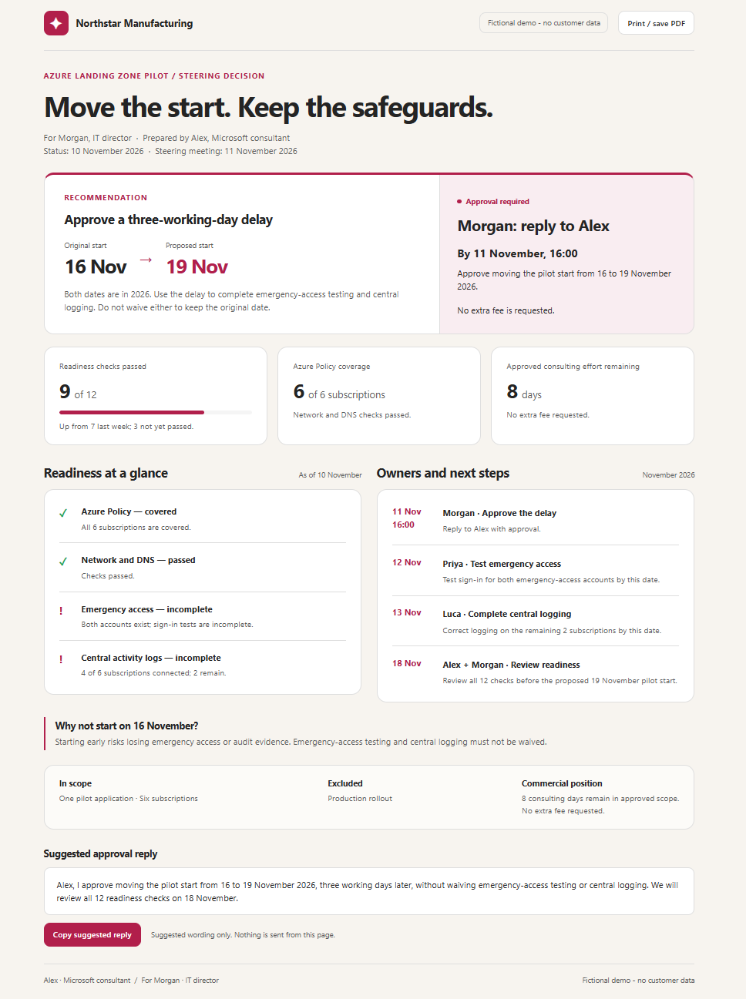
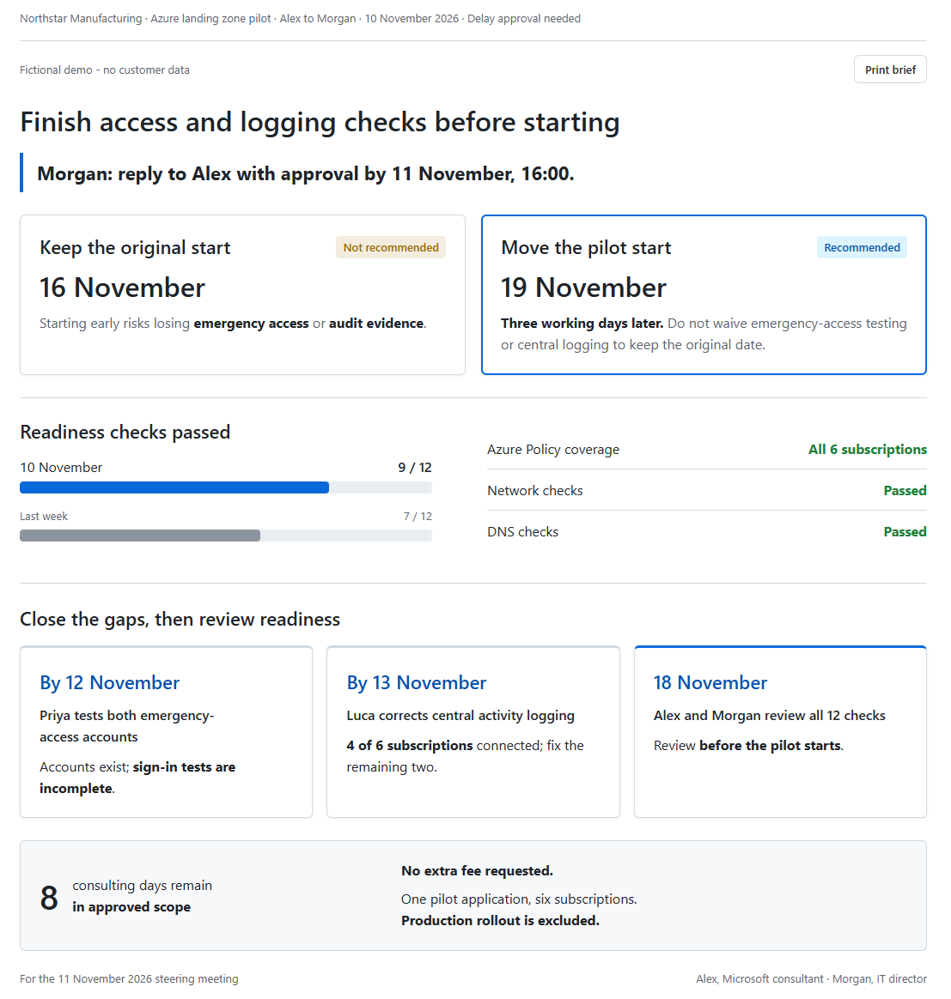
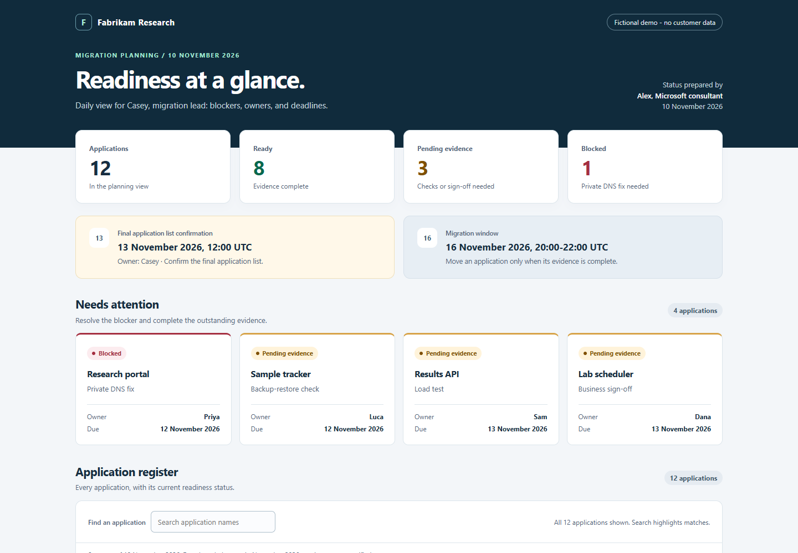
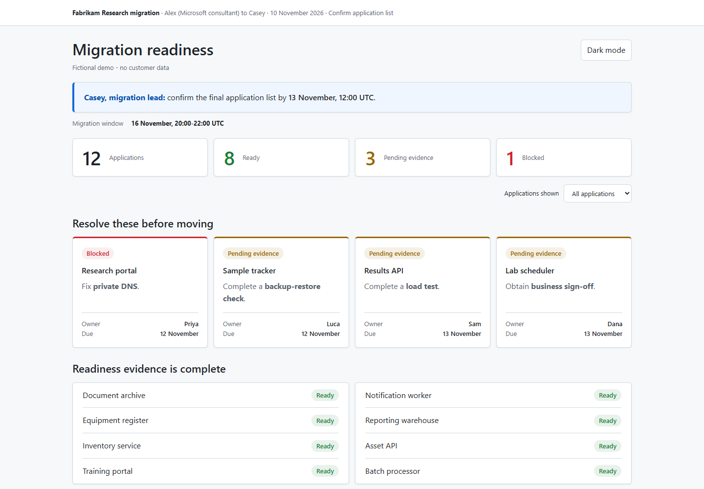
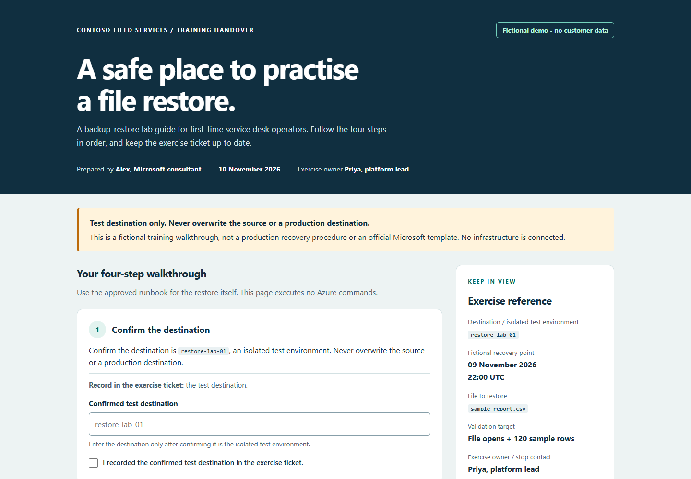
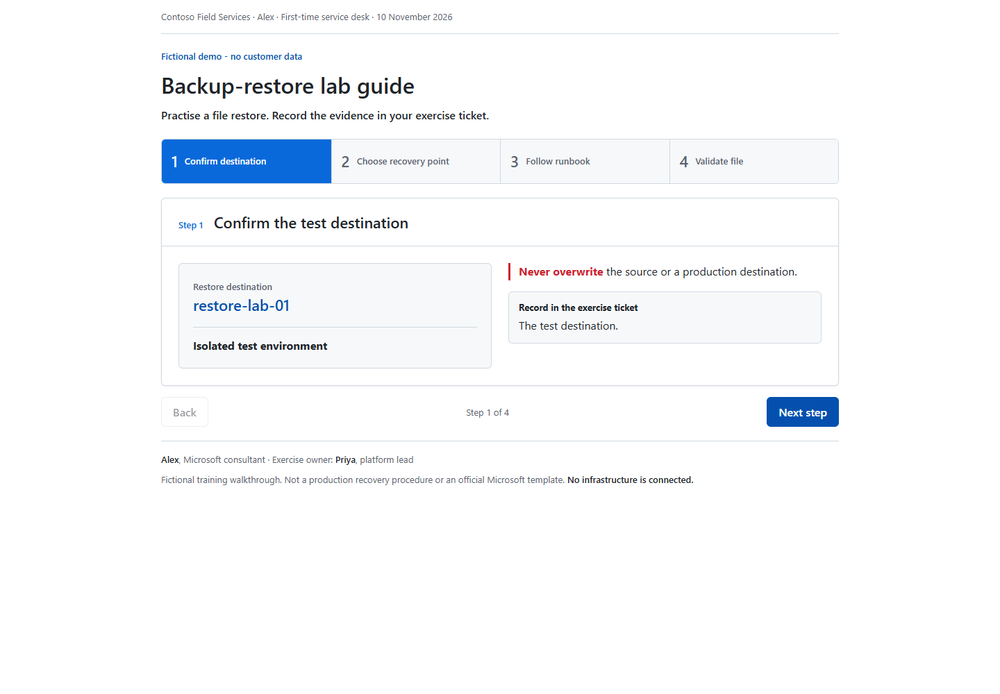

## Grenade for GitHub Copilot

Based on [Grenade by Ruben Hassid](https://github.com/rubenhassid1/grenade),
originally developed for Claude and shared through his
[How to AI newsletter](https://ruben.substack.com). This fork adapts Ruben's
reader-first design approach for GitHub Copilot.

Make HTML pages that someone with zero context can understand in five seconds.
The **noslop** skill picks the layout from the reader's job, puts visuals before
paragraphs, and uses GitHub-inspired colors, typography, and light/dark themes.

This fork targets **GitHub Copilot CLI and GitHub Copilot in VS Code**. It replaces
the upstream Claude integration; it does not depend on Claude or an API key.
You need access to GitHub Copilot and a client that supports Agent Skills.

## How this fork works

Ruben's original README is the instruction set: you ask Claude to make a page
and follow the linked repository. In this fork, the README explains installation
and usage; the design instructions live in the
[noslop skill](.github/skills/noslop/SKILL.md).

For reuse across projects, install this fork as a **Copilot plugin**. The plugin
packages the skill so Copilot can discover it without fetching a repository URL
in every conversation. A skill supplies the workflow; a plugin distributes it.
This repository already includes the plugin manifest and marketplace catalog.

Follow the [Copilot CLI installation](#github-copilot-cli) or
[VS Code setup](#github-copilot-in-vs-code), then ask:

```text
Use the noslop skill to make an HTML page about [YOUR TOPIC] for [WHO WILL READ IT].
They need to [DECIDE / LEARN / CHECK SOMETHING] and will [READ ONCE / RETURN DAILY].
```

For a single project, opening this checkout or copying the skill into that
project also works; plugin installation is optional. Packaging improves
discovery and reuse, not a guarantee of better generated pages.

## See the difference: without and with noslop

### Pilot readiness

**The task:** make an Azure pilot readiness page so an IT director can approve
a three-day delay. Both runs use the fictional brief in
[example 1](#1-azure-pilot-readiness-a-decision-for-an-it-director).
The model shown in both sessions is **GPT-6.1 Sol**.

<table>
  <thead>
    <tr>
      <th width="50%">Without noslop</th>
      <th width="50%">With noslop</th>
    </tr>
  </thead>
  <tbody>
    <tr>
      <td valign="top">
        <a href="assets/example-3.png">
          
        </a>
      </td>
      <td valign="top">
        <a href="assets/example-6.png">
          
        </a>
      </td>
    </tr>
    <tr>
      <td valign="top">Compact status summary; recommendation and metrics grouped together.</td>
      <td valign="top">Approval first; options and readiness changes shown visually.</td>
    </tr>
  </tbody>
</table>

**Look for:** the approval deadline, the two start dates, and progress from
7 to 9 passed checks. Which version lets you find each faster?
Click either image to read it at full size.

Both outputs are usable; this is not a deliberately bad baseline. These are
individual runs, not a controlled benchmark, and the capture dimensions differ.

<details>
<summary>See the prompts and Copilot session screenshots</summary>

| Run | Prompt screenshot | Completion screenshot |
| --- | --- | --- |
| Without noslop | [View prompt](assets/example-1.png) | [View completion](assets/example-2.png) |
| With noslop | [View prompt](assets/example-4.png) | [View completion](assets/example-5.png) |

The startup captures show a skill-loading warning without identifying the
failed skill. They do not independently confirm that noslop loaded; check skill
activation when reproducing the comparison.

</details>

### Migration wave

**The task:** help a migration lead find blockers, owners, and deadlines across
12 applications. Both runs use [example 2](#2-migration-wave-a-daily-view-for-the-migration-lead).

<table>
  <thead>
    <tr>
      <th width="50%">Without noslop</th>
      <th width="50%">With noslop</th>
    </tr>
  </thead>
  <tbody>
    <tr>
      <td valign="top">
        <a href="assets/migration-without.png">
          
        </a>
      </td>
      <td valign="top">
        <a href="assets/migration-with.png">
          
        </a>
      </td>
    </tr>
    <tr>
      <td valign="top">Summary tiles, deadlines, exception cards, then a full register.</td>
      <td valign="top">Deadline first; all 12 application names fit in view.</td>
    </tr>
  </tbody>
</table>

**Look for:** Casey's confirmation deadline and Priya's DNS blocker. Both pages
highlight exceptions; the noslop version uses less vertical space before the
ready applications. Click either image for the full-size capture.

### Operations handover

**The task:** guide a first-time operator through a four-step backup-restore
lab. Both runs use [example 3](#3-operations-handover-a-guide-for-first-time-operators).

<table>
  <thead>
    <tr>
      <th width="50%">Without noslop</th>
      <th width="50%">With noslop</th>
    </tr>
  </thead>
  <tbody>
    <tr>
      <td valign="top">
        <a href="assets/handover-without.png">
          
        </a>
      </td>
      <td valign="top">
        <a href="assets/handover-with.png">
          
        </a>
      </td>
    </tr>
    <tr>
      <td valign="top">Scrolling worksheet with input fields and an exercise reference.</td>
      <td valign="top">One step at a time, with Back and Next.</td>
    </tr>
  </tbody>
</table>

**Look for:** the test destination, overwrite warning, and next action. These
are the initial screens: the noslop guide reveals later instructions through
navigation rather than scrolling. The baseline offers editable ticket fields;
the noslop version focuses on reading and following the procedure.

<details>
<summary>How the migration and handover comparisons were made</summary>

- **Model and date:** GPT-6.1 Sol, 10 November 2026.
- **Prompts:** the README briefs below, unchanged except for adding
  `Use the noslop skill.` to each with-noslop run.
- **Isolation:** four fresh sessions in separate empty folders; matching
  built-in skills, no personal skills, and noslop available only in the two
  with-noslop sessions. Both logs explicitly confirm `skill(noslop)`.
- **Captures:** Microsoft Edge, 1440 x 1000 viewport, light color preference,
  reduced motion, initial page state, and no scrolling.
- **Outputs:** the first completed generation from each session, without
  hand-editing or rerolling. Screenshots are unedited. These are illustrative
  comparisons, not a guarantee that every task improves.

</details>

## Try it yourself: without and with noslop

Run each prompt below twice to compare the results yourself. All organizations,
people, dates, and figures are fictional; no customer data or Azure access is
needed. These are example briefs, not official Microsoft templates.

### Set up a fair comparison

Use the **same Copilot client, model, and prompt** for each pair. Start each run
in a fresh chat and a separate empty folder outside this repository so neither
run can read the other's output. Keep other instructions and skills unchanged.

**Without noslop:** disable the skill before starting the first session:

```shell
copilot skill disable noslop
copilot
```

Paste one of the prompts below unchanged. Save the result, exit the session,
then switch to the second empty folder.

**With noslop:** enable the skill and start a fresh session:

```shell
copilot skill enable noslop
copilot
```

Paste the same prompt, adding only this line at the beginning:

```text
Use the noslop skill.
```

Confirm that the second run loads the skill. `copilot skill list` shows available
skills; a repository-level disabled setting must also be removed if it blocks
the skill. In VS Code, use the skill enable/disable control and a fresh Agent
chat for each run instead of the terminal commands.

Do not deliberately ask for a bad "without" page. Both runs should try to solve
the task well. Results vary, and the baseline may already be good.

### 1. Azure pilot readiness: a decision for an IT director

Compare how quickly you can find the requested decision, deadline, and blockers.

```text
Create a standalone HTML status page for a fictional Azure landing zone pilot.
Save it as report.html with inline CSS and JavaScript. Make it visually appealing
and easy to understand. Do not publish it or connect to Azure.

The reader is Morgan, IT director at fictional Northstar Manufacturing.
Alex, a Microsoft consultant, is preparing this for the 11 November 2026
steering meeting. Morgan will read it once to decide whether to approve a delay.

Status on 10 November: 9 of 12 readiness checks passed, versus 7 last week.
Azure Policy covers all 6 subscriptions. Network and DNS checks passed.
Emergency-access accounts exist but sign-in tests are incomplete.
Central activity logs are connected for 4 of 6 subscriptions.

Recommend moving the pilot start from 16 to 19 November: three working days
later. Do not waive emergency-access testing or central logging to keep the
original date. Starting early risks losing emergency access or audit evidence.
Morgan must reply to Alex with approval by 11 November at 16:00.

Priya must test both emergency-access accounts by 12 November.
Luca must correct logging on the remaining two subscriptions by 13 November.
Alex and Morgan review all 12 checks on 18 November before the pilot starts.
Eight consulting days remain in approved scope; no extra fee is requested.
Scope: one pilot application, six subscriptions; production rollout is excluded.

Mark the page "Fictional demo - no customer data". Use only these facts.
You have the reader and purpose; build the page without asking questions.
```

**Screenshots:** capture the same first viewport in both outputs. Can a reader
identify what Morgan must approve without reading the whole page?

### 2. Migration wave: a daily view for the migration lead

Compare whether the page highlights exceptions or gives every application
equal visual weight.

```text
Create a standalone HTML migration dashboard for fictional Fabrikam Research.
Save it as report.html with inline CSS and JavaScript. Make it visually appealing
and easy to understand. Do not publish it or connect to Azure.

Casey, the migration lead, will check this daily to find blockers, owners,
and deadlines. Alex, a Microsoft consultant, prepared the status on
10 November 2026. The migration window is 16 November, 20:00-22:00 UTC.
Casey must confirm the final application list by 13 November, 12:00 UTC.

There are 12 applications: 8 ready, 3 pending evidence, and 1 blocked.
Research portal is blocked by private DNS: Priya owns the fix, due 12 November.
Sample tracker needs a backup-restore check: Luca, due 12 November.
Results API needs a load test: Sam, due 13 November.
Lab scheduler needs business sign-off: Dana, due 13 November.
Those last three applications are pending evidence.

The eight ready applications are Document archive, Equipment register,
Inventory service, Training portal, Notification worker, Reporting warehouse,
Asset API, and Batch processor. Their readiness evidence is complete.

Move an application only when its evidence is complete. If a moved application
fails its smoke test, restore its source routing. Source systems remain
available until validation completes. This is a planning view, not a runbook.
Keep every application's name and status available to the reader.

Mark the page "Fictional demo - no customer data". Use only these facts.
You have the reader and purpose; build the page without asking questions.
```

**Screenshots:** use the same viewport and initial state. Can Casey immediately
find the blocker and who needs to act? Also try any disclosure controls.

### 3. Operations handover: a guide for first-time operators

Compare whether a first-time operator can follow the procedure and spot when
to stop, rather than having to interpret a long document.

```text
Create a standalone HTML backup-restore lab guide for fictional Contoso Field
Services. Save it as report.html with inline CSS and JavaScript. Make it visually
appealing and easy to understand. Do not publish it or connect to Azure.

Alex, a Microsoft consultant, prepared this handover on 10 November 2026.
The readers are first-time service desk operators. They will reuse the guide
to practise a file restore. Priya, platform lead, owns the exercise.

Step 1: Confirm the destination is restore-lab-01, an isolated test environment.
Never overwrite the source or a production destination.
Record the test destination in the exercise ticket.

Step 2: Choose the fictional recovery point 09 November 2026, 22:00 UTC.
If it is unavailable, stop and contact Priya.
Record the recovery-point timestamp.

Step 3: Follow the approved workload-specific runbook to restore
sample-report.csv into the test destination. Record the restore job ID.
The HTML guide itself must execute no Azure commands.

Step 4: Confirm the restored file opens and contains 120 sample rows.
Attach the job ID and validation result to the exercise ticket.
If either check fails, stop and contact Priya before retrying.

This is a fictional training walkthrough, not a production recovery procedure
or an official Microsoft template. No infrastructure is connected.
Mark the page "Fictional demo - no customer data". Use only these facts.
You have the reader and purpose; build the page without asking questions.
```

**Screenshots:** start at the beginning in both versions, then try the full
procedure. Does the page make the safe destination and stop conditions obvious?

### Capture your own comparisons

Open each generated `report.html` in the same browser, with the same window size,
zoom, theme, and scroll position. Capture the first screen without changing the
generated content. Record the model and date alongside the images.

All three example pairs are shown above. To add another comparison, place
your screenshots in `assets` and show them side by side in this README. Label them
**Without noslop** and **With noslop**; describe the observed differences rather
than promising an improvement the screenshots do not show.

## GitHub Copilot CLI

Install the Copilot version directly from this fork's `main` branch:

```shell
copilot plugin install stefanstranger/grenade
```

Or install through its marketplace (use one installation method, not both):

```shell
copilot plugin marketplace add stefanstranger/grenade
copilot plugin install noslop@grenade
```

Start a new Copilot session in your working folder. Ask Copilot to use the
**noslop** skill, and include your notes or file paths:

```text
Use the noslop skill to make monthly-report.html from these notes for my manager.
They need to decide which two projects to fund and will read it once.
```

Check availability with `copilot plugin list` and `copilot skill list`.
For local development, you can optionally load this checkout from its root:

```shell
copilot --plugin-dir .
```

The remote install commands use the fork's default branch, `main`, which already
contains the Copilot version. A local checkout is not required for installation.

## GitHub Copilot in VS Code

Open this checkout in VS Code, sign in to GitHub Copilot, and select **Agent**
mode in Chat. VS Code discovers the skill at
[.github/skills/noslop/SKILL.md](.github/skills/noslop/SKILL.md) as a project skill.
Start a new chat after adding or changing the skill, and ask to use **noslop**.

To use it in another project, copy the entire `.github/skills/noslop` directory
into that project's `.github/skills` directory. No extension, API integration,
or duplicate instruction file is required.

On VS Code versions with agent plugin support, you can instead run
**Chat: Install Plugin from Source** and enter
`https://github.com/stefanstranger/grenade`, or select this checkout's directory
for local development. Review the installed skill in
**Chat: Open Customizations**. Plugin support must be enabled for this route;
copying the project skill does not require plugins.

## Make, fix, or build a website

Give Copilot the reader, the job, and whether they will read once or return.
If any are missing, the skill asks before building.

**Make a page:**

```text
Use noslop to make an HTML decision page from notes.md for the finance lead.
They need to choose a vendor by Friday and will read it once.
```

**Fix an existing page:**

```text
Use noslop to fix dashboard.html for our operations team.
They check it daily to see overdue work. Save the redesign as a new HTML file.
```

**Build the web version:**

```text
Use noslop to make a website from notes.md for the sales team.
They will use it weekly to price deals. Build locally; do not publish yet.
```

Standalone pages are real `.html` files with inline CSS and JavaScript, not
chat-only artifacts. Open them in a browser. The optional web version uses Vite,
React, TypeScript, Tailwind CSS, shadcn/ui, Recharts, Motion, and lucide-react.
Publishing to GitHub/Vercel requires their tools and accounts and an explicit
request to publish; a local HTML page needs neither.

## Development

The canonical instructions live in `.github/skills/noslop/SKILL.md`. The root
`plugin.json` points there so plugin installs and project-skill discovery use
the same file. The marketplace catalog is `.github/plugin/marketplace.json`.
No Claude plugin manifests are shipped.

Run the dependency-free packaging and installation checks with Node.js 22 or later:

```shell
node --test
```

Format references: [Copilot CLI plugins](https://docs.github.com/en/copilot/reference/copilot-cli-reference/cli-plugin-reference)
and [VS Code Agent Skills](https://code.visualstudio.com/docs/copilot/customization/agent-skills).

## Credits and license

Adapted for GitHub Copilot from [Ruben Hassid's Grenade](https://github.com/rubenhassid1/grenade),
the original Claude version, from the [How to AI newsletter](https://ruben.substack.com).
Thanks to [unslop](https://github.com/heydamir/unslop) by Damir Sokolovsky for three
of the original ideas. Original attribution and the [MIT license](LICENSE) are retained.
